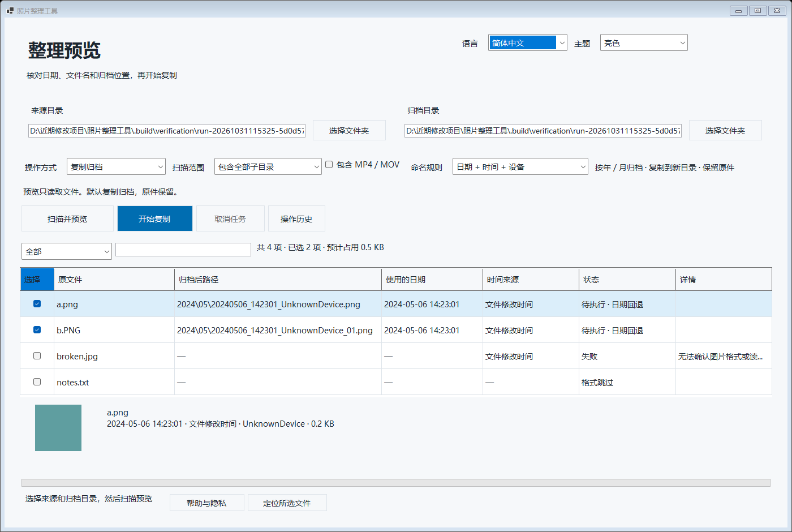
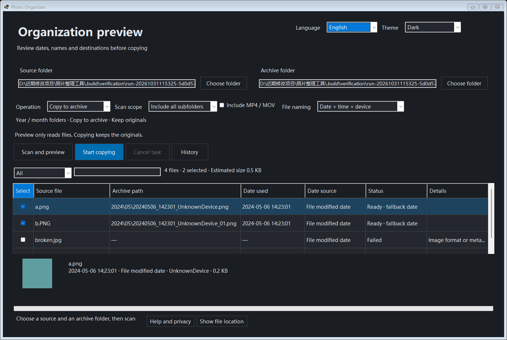
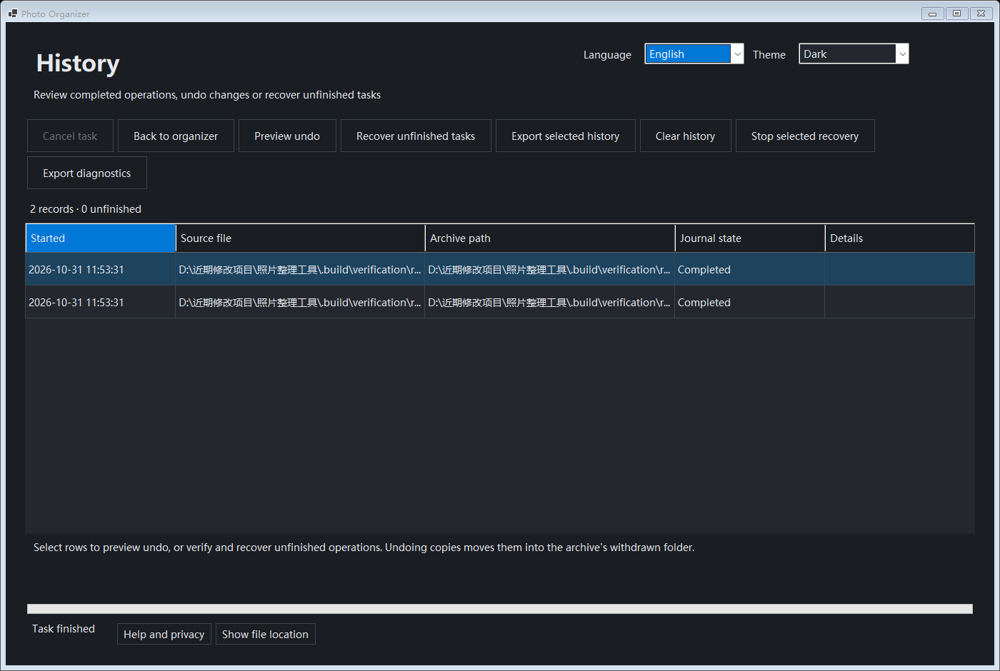
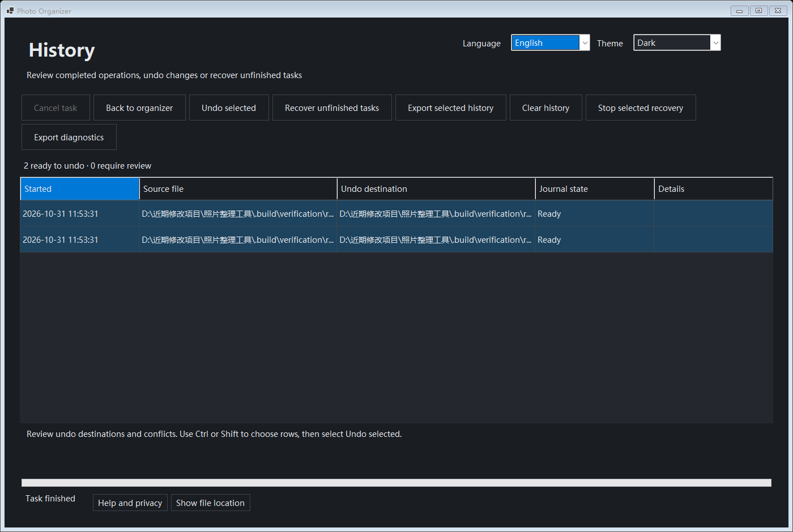

# 照片整理工具 (Photo Organizer)

一款运行于 Windows 11 的本地照片与视频批量整理桌面工具。支持读取照片 EXIF 拍摄时间与设备信息，在执行写入前提供完整只读预览、冲突检测与日期回退标记，并通过 SHA-256 校验、文件身份核对与 SQLite 事务日志保障文件安全，支持中断恢复与历史撤销。

> **当前版本**：`1.0.0-rc.1` · **目标平台**：Windows 11 x64 (最低构建 26100) · **技术栈**：C# / .NET 10 (`net10.0-windows`) / WinForms / SQLite / MetadataExtractor

---

## 界面预览

| 中文亮色预览 | 英文暗色预览 |
| :---: | :---: |
|  |  |

| 操作历史记录 | 撤销预览确认 |
| :---: | :---: |
|  |  |

---

## 核心特性

### 1. 智能日期识别与扫描范围
- **多级时间提取**：支持 `JPG`、`JPEG`、`PNG` 格式元数据读取，按 **EXIF 原始拍摄时间 → 数字化时间 → IFD0 时间** 依次提取；缺失 EXIF 时回退至文件修改时间并在预览中明确标记。
- **可选视频归档**：支持勾选 `MP4`、`MOV` 视频文件，按文件修改时间一并复制归档。
- **灵活目录扫描**：支持拖入或选择文件夹，提供 **仅本层目录**、**递归全部子目录**、**仅一级年份目录（1901～2999）** 三种扫描范围。

### 2. 归档复制与原地改名
- **复制归档（默认推荐）**：按 `年/月` 目录结构复制到独立的本地 NTFS 归档目录，完整保留原件不修改。
- **同目录原地改名**：在来源文件夹直接批量重命名。遇到携带同名伴随文件（`MOV` / `AAE` / `XMP` / `RAW`）的照片组时自动保护性跳过，防止破坏动态照片或修图配置关联。
- **多种命名规则**：支持保留原文件名、按「日期 + 设备型号」命名以及兼容旧版格式命名；同秒重名自动生成稳定递增编号，自动识别同内容重复文件。

### 3. 只读预览与交互筛选
- **预览零写入**：扫描与规划阶段完全只读，不改动任何来源或目标文件。
- **高性能虚拟列表**：支持万级照片流畅滚动浏览、关键词搜索筛选、逐项勾选/取消、按需加载缩略图与一键在资源管理器中定位文件。
- **实时进度与剩余时间**：批量扫描、复制校验、改名、恢复和撤销均提供阶段进度、当前文件名、采样剩余时间估算（ETA）及安全取消。

### 4. 数据安全、中断恢复与可逆撤销
- **防损坏与防覆盖提交**：复制采用临时暂存文件写入 → SHA-256 哈希比对 → 文件身份核验 → 禁止覆盖提交；取消操作仅清理经身份验证的自身暂存文件，磁盘空间不足时立即安全停止整批任务。
- **跨实例目录互斥**：同一来源或归档根目录具备跨进程写入互斥锁，防止多开窗口同时操作同一目录。
- **SQLite 持久意图日志**：记录每一步操作意图与文件身份信息。若进程意外中断，重启后可核对未完成记录并安全恢复或显式放弃。
- **安全撤销机制**：支持在操作历史中预览并执行撤销。撤销前严格校验文件身份、内容哈希与目标占用状态（被外部替换或修改过的文件拒绝自动撤销）；复制归档撤销会将副本移入归档目录下的 `.photo-organizer-withdrawn` 文件夹，不直接永久删除。

### 5. 多语言与外观体验
- **双语即时切换**：内置简体中文与英文界面（`zh-CN` / `en-US`），切换无需重启。
- **主题与高对比度**：支持亮色、暗色、跟随系统主题，兼容 Windows 高对比度模式与 `PerMonitorV2` 多显示器高 DPI 缩放。

---

## 目录结构

```text
.
├── PhotoOrganizer/             # 主程序源码 (WinForms, .NET 10)
│   ├── Docs/                   # 应用内隐私说明与第三方开源许可文本
│   ├── Locales/                # 多语言资源文件 (zh-CN.json, en-US.json)
│   ├── Planner.cs              # 扫描、EXIF 提取与重命名/归档规划核心
│   ├── CopyExecutor.cs         # 暂存复制、SHA-256 校验与安全提交执行器
│   ├── RenameExecutor.cs       # 同目录原地改名与伴随文件保护执行器
│   ├── Journal.cs              # SQLite 持久意图日志与数据库迁移
│   ├── HistoryService.cs       # 历史查询、中断恢复与撤销校验服务
│   ├── FileIdentity.cs         # Windows 文件身份标识与校验
│   ├── OperationLock.cs        # 跨进程同根目录写入互斥锁
│   └── MainForm.cs             # 主界面与交互逻辑
├── PhotoOrganizer.Tests/       # 自动化集成与 UI 测试工程 (82 项断言)
├── packaging/                  # 应用图标与 MSIX 打包清单模板
├── scripts/                    # 工具链准备、构建、测试、打包与认证验证脚本
├── 发布资料/                   # 微软商店上架文案、隐私政策草稿与真实界面截图
├── 发行版/                     # 本地构建的自包含便携版与候选安装包
├── changname/                  # 早期旧版参考工程
├── 开发说明.md                 # 开发、构建、运行与诊断详细说明
├── 交付与测试报告.md           # 自动化测试、性能样本、安装生命周期与 WACK 报告
└── 照片整理工具开发与上架计划.md # 完整架构设计与阶段执行计划
```

---

## 快速开始

### 方式一：直接运行便携版

如果目录下包含已打包的发行版，可直接运行自包含程序（内置 .NET 10 运行时，无需额外安装环境）：

```text
发行版/照片整理工具-1.0.0-rc.1-x64/PhotoOrganizer.exe
```

> **提示**：请保留整个文件夹完整结构，不要单独复制 `PhotoOrganizer.exe`。首次使用建议先用照片副本体验归档与撤销流程。

### 方式二：从源码构建与测试

在项目根目录下打开 PowerShell，依次执行以下脚本：

```powershell
# 1. 准备或校验本地 .NET 10 SDK 工具链
& .\scripts\Prepare-Toolchain.ps1

# 2. 还原锁定依赖、执行 NuGet 审计并编译 Release 版本
& .\scripts\Build.ps1

# 3. 运行全部 82 项自动化单元测试与 STA WinForms 集成测试
& .\scripts\Test.ps1 -SkipBuild

# 4. 生成自包含便携目录、MSIX 与 MSIXUPLOAD 候选包
& .\scripts\Package.ps1
```

导出运行诊断信息：

```powershell
& .\发行版\照片整理工具-1.0.0-rc.1-x64\PhotoOrganizer.exe --diagnostics-file .\artifacts\diagnostics.json
```

---

## 数据存储与隐私

- **完全离线运行**：所有扫描、EXIF 解析、哈希校验与文件整理均在本机完成，不上传任何照片或路径数据，不包含内置遥测。
- **本地存储位置**：
  - 便携直接运行版：`%LOCALAPPDATA%\PhotoOrganizer`
  - MSIX 安装版：`%LOCALAPPDATA%\Packages\<PackageFamilyName>\LocalState\PhotoOrganizer`
- **边界说明**：当前版本不解码 `HEIC` / `RAW` 图像，不支持云盘在线占位文件、网络路径或目录联接（Junction），未知格式文件保持原样跳过。

---

## 相关文档

- [开发与运行说明 (`开发说明.md`)](开发说明.md)
- [交付与测试报告 (`交付与测试报告.md`)](交付与测试报告.md)
- [开发与上架计划 (`照片整理工具开发与上架计划.md`)](照片整理工具开发与上架计划.md)
- [微软商店发布资料 (`发布资料/商店上架材料.md`)](发布资料/商店上架材料.md)
- [隐私政策草稿 (`发布资料/隐私政策.md`)](发布资料/隐私政策.md)
